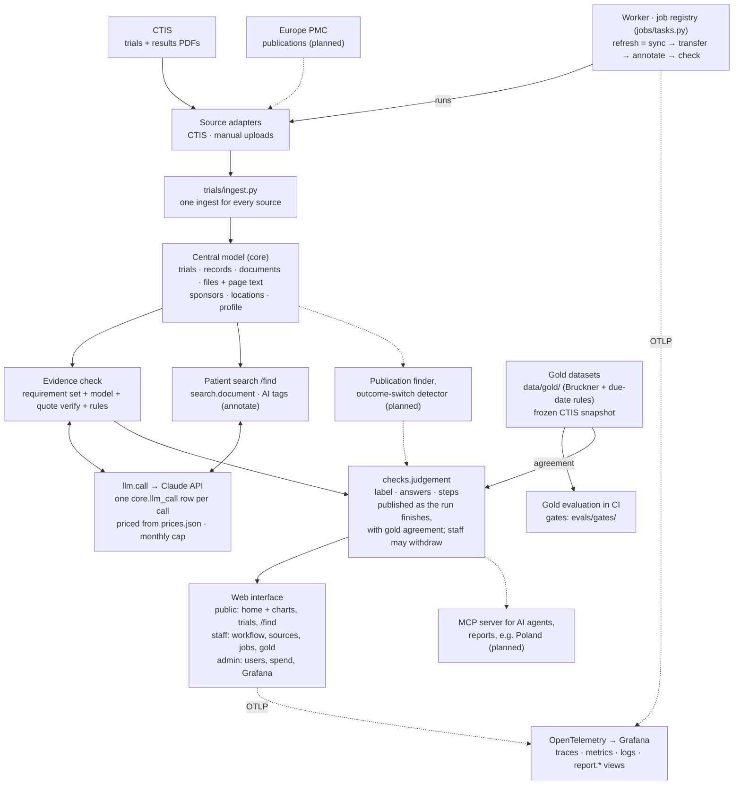
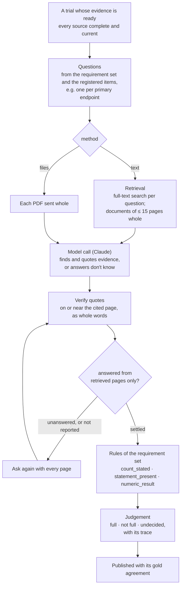
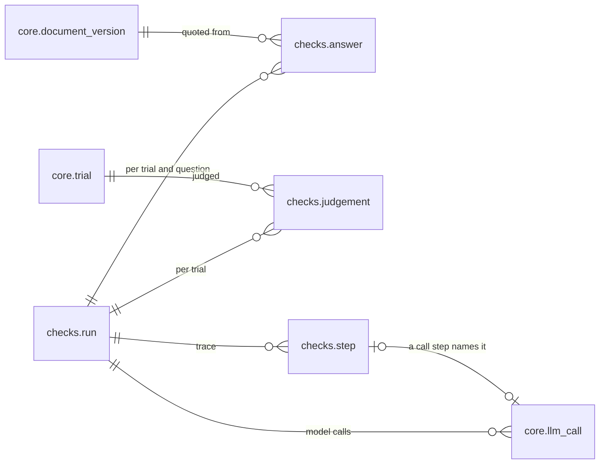

# Automated checks

A check judges whether a trial's results are reported completely. Every judgement without an error is published
with its full trace and its agreement with the gold datasets ([ADR-007](adr/ADR-007-public-and-staff-data.md)).
There is one check, the **evidence check**: a model finds and quotes evidence, code checks the quotes, rules
decide ([ADR-004](adr/ADR-004-generic-check-requirements-as-data.md)). Bruckner et al.'s due-date rules are code too,
but they only build the gold data ([below](#due-date-rules)). Not built yet: the reviewers' per-part checks, the
Europe PMC connector, the publication finder and the outcome-switch detector.



## How the evidence check judges a trial



- **Ready evidence only.** A check reads a trial only when every source that holds it gave its evidence
  completely and nothing changed at the source since (see [Sources](sources-and-gold.md#evidence-state)). A stale
  trial is transferred again first, so a sponsor's corrected document is never judged by its old copy; the CLI,
  the web interface and the jobs refuse the others and say why.
- **Setup.** A check runs with a named setup, `--config` (default `default`): a file in
  `src/trialwatch/checks/configs/` holding the model and its effort (how hard it thinks: low … max), the system
  prompt, the requirement set, the check method and the retrieval settings. `check configs` lists them, the web
  forms offer them by name, and every run records the setup's name and every value it used, so editing a file
  never changes what an earlier run says. Trying other settings means adding a setup file (`whole-files` sends each
  PDF whole).
- **Requirement set.** What a trial must report and how "enough" is decided, as data:
  `src/trialwatch/checks/requirement_sets/eu-ctr-results.json`, read by `checks/requirements.py`. It names the
  document kinds to read, the requirements (a question, or one per registered item such as each primary endpoint,
  with search hints and a rule type), the parts they count towards, and its labels: tried in order, the first
  whose condition on the parts holds (`when_any`, `when_all`; the last has none), each saying what it means next
  to a gold label (`accusation`, `clears` or `open`). Answer kinds besides `numeric_result` count as reported
  (`reported_kinds`: `partial_result`, data for some of an endpoint's components, as the gold reviewers count
  it), mean "not reported" (`not_reported_kinds`) or leave the question to a person (`open_kinds`:
  `not_conducted`, a result of a stage of the trial that never started or enrolled nobody, is neither reported
  nor missing). The last two are asked again with every page when first seen on retrieved pages. Gold scoring reads those meanings, so a set with other
  labels is scored the same way. The web interface's Requirements page shows every set.
- **System prompt.** `src/trialwatch/checks/prompts/evidence.md`. It names no registry, document type or
  regulation; the trial, its documents and the questions are given per call from data, each fenced in tags. Text
  in a PDF that looks like one of those tags (`<page`, `</document`) has its `<` replaced, so a document can't end
  its page early and speak to the model as if it were our instructions.
- **No versions before production.** One current text of each prompt, setup and requirement set; every run
  stores the exact texts it used with their sha256, so an earlier run always shows its own.
- **Method.** `text`: the documents' extracted page text, searched per question with the words of the
  requirement's hints and of the registered item (Postgres full-text search, `checks/retrieval.py`). `files`:
  each document's file sent whole, so the model also reads scanned pages and charts. Both use the same
  requirement set, prompt, answer format, quote verification (against the page text), rules, tables and trace.
- **Verified quotes only.** A quote counts only if it is at least 10 characters long and found on the page it
  cites as whole words, ignoring case, spacing, dash and quote-mark variants and line-end hyphens
  (`checks/verify.py`). Spacing inside words and numbers is ignored too (a table cell's text comes out of the PDF
  broken across lines), as long as the quote starts and ends on the page's word edges. A quote found not on the
  cited page but up to 2 pages from it in the same document counts, and the evidence names the page it is on (the
  verification trace keeps the cited one as `cited_page`). A page counts as read only if its text layer holds at least 200 letters: on a scanned
  page "not found" can't mean "not reported". A cover, signature, legend or contents page also falls under that
  line, so the setup allows a few (`unreadable_pages_allowed`, 1 by default): with at most that many such pages,
  and at least one readable one, answers from every page still count as the whole document. The trial page
  shows which pages had no text.
- **Don't know, and widening.** The model may answer `dont_know` (stored as `checks.answer.found` NULL) when it
  can't tell. A question not answered from retrieved pages, or an endpoint found there only as not reported, is
  asked again with every page, so a retrieval miss never becomes "not reported". What the rules still can't
  settle is **undecided**, never a guess.
- **Refusal fallback.** If the model's safety checks decline a request, the API may re-run it on another model
  Anthropic recommends; the answer records which model served it.
- **Trace.** Every step of judging one trial in one run is stored in order (`checks.step`): the questions, the
  documents and pages read, retrieval (terms, ranks, snippets), each model call (what was asked; the call
  itself, the request exactly as sent, the model that answered, tokens, time and its raw answer, is its
  `core.llm_call` row, which the step names), quote verification and the rules (how each part was set: the
  judgement's trace). The system prompt is stored once per run.
- **Runs are versions.** Each run (`checks.run`) adds new rows, never updates; `checks.judgement_current` shows
  the newest judgement per trial and requirement set. A judgement is **outdated** when a document version it read
  was replaced or unlinked, a document of the kinds its set reads was linked since, or another record of the trial
  came in after its run started. It still shows, marked outdated; check the trial again. A run whose process died
  is closed as failed by the next run (an advisory lock is held while it is alive).

## Publication

Every judgement without an error is published by its run as the run finishes (also when it stopped part-way),
whatever its label (full, not full or undecided) and however well judgements of its kind agree with the gold
datasets; nobody publishes by hand and nothing waits for review. Each publication records that agreement for
everyone to see: the share of gold items that judgements of the same kind (model, prompt text, requirement set,
label, quotes verified, asked again with every page, a question unanswered) agreed with, once at least 20 were
compared, and in words how many agreed of how many, from which datasets (`src/trialwatch/checks/publishing.py`).
A run is measured only by runs started before it, so a run that checks gold trials never counts its own
judgements towards its own agreement. The trial page shows the agreement recorded at publication; it is not
recomputed on each view.

A moderator or admin may withdraw a published judgement with a reason (`judgement.withdraw`); it stays public,
marked withdrawn with that reason and the date, so nothing disappears silently. This is the only manual step.

**What the public sees** (`view.published`): the home page's table of trials with a published result (when it
was checked and published, by which model), searchable by identifier, title or sponsor and filtered by country,
city, result, registry status and the day it was checked; when the last scheduled run was and the next is due;
how much the model calls have cost so far. From the table, a trial with a published judgement: where it runs
(each site with its city and postcode, by country, with the trial's status there; never the people at a site) and
how its evidence was collected, as staff see it: the questions, the pages searched and read, the system prompt
and the exact message sent, the model's raw answer, each quote checked against its page, and the rules that
decided; with that run's page, the prompts, the requirement sets and the documents it quotes. Judgements of a run
still going or one that failed, costs, staff names, sources and transfers stay with staff. Recruiting trials have
public pages of their own ([search](search.md), ADR-008).

## Due-date rules

`src/trialwatch/gold/converters/due_date.py`: Bruckner et al.'s rules for which trials are due and whether results came on
time, in plain code, no model. `tests/test_due_date.py` checks that they reproduce all 277 of their verdicts from
their files in `data/bruckner/`.

## Running a check

```bash
uv run trialwatch check evidence --all --dry-run
```

`check evidence CT…` checks named trials, `--all` every trial whose evidence is ready; without `--dry-run` it calls
the model (`ANTHROPIC_API_KEY` from `.env`). On the web interface, model checks start as dry runs: untick "dry
run" to send. A trial can be checked again, also with another setup to compare runs. The refresh checks,
with the default setup, the trials never judged or whose judgement is outdated ([operations](operations.md#jobs-the-worker-and-the-refresh)).

The command line, the worker's check job and the gold evaluation all run a check the same way (`run` in
`checks/evidence.py`), and a dry run shows the same preview everywhere. Only what happens to a trial whose evidence
is not complete and current differs, by who chose it: a trial a person asked for is refused before anything is sent,
with why; a trial TrialWatch chose (the refresh) or a gold evaluation took is left out, and the run's summary says
why. With no trial left, no run is started.

## Code

| Where | What |
|---|---|
| `checks/evidence.py` | the evidence check's one entry point, `run` (the command line, jobs and gold evaluations all use it), and `check_trial`'s steps: gather, questions, ask, verify, judge, save |
| `checks/ask.py` | the request of a call (page text or whole files, one skeleton) and the answers by key |
| `checks/trace.py` | the trace steps a trial's page shows |
| `checks/retrieval.py` | full-text search per question |
| `checks/verify.py` | quote verification, readable pages |
| `checks/requirements.py`, `requirement_sets/` | requirement sets and their rules |
| `checks/settings.py`, `configs/` | setups |
| `checks/prompts/` | the system prompts and loading them |
| `llm.py` (shared) | the model call and its cost |
| `checks/publishing.py` | publication and its gold agreement |
| `checks/routes.py`, `checks/views.py` | the run, prompts and requirements pages, withdrawing a judgement; the trace as the trial page shows it |
| `gold/converters/due_date.py` | due-date rules (the Bruckner converter uses them) |
| `db/checks.py` | their SQL |

## Tables



| Table | What it holds |
|---|---|
| `checks.run` | one check run: who ran it, model, effort, prompt and requirement set (name, sha256, text as sent), params (method, top_k, …), status (running, succeeded, failed, stopped) and why it ended early, counts, job; its tokens and cost are its calls' (`core.llm_call`) |
| `checks.answer` | each question a run asked about a trial (`participants`, `cancelled`, `endpoint:<registered id>`, …): the registered item it is about, the pages shown, whether it was asked again with every page; and the model's answer, if it gave one (`evidence_id`, which the rules trace names): found (true, false, NULL = don't know), kind (numeric_result, narrative_only, chart_only, redacted, not_analysed, not_conducted, partial_result, other), the quote, document version, file sha256 and page, and whether the quote is really on that page |
| `checks.judgement` | the rules' verdict per trial per run: label (full, not full, undecided; NULL only with an error), parts by name (NULL = undecided), the rule and evidence behind each, the inputs read (trial record, document versions), the models that served it (its rules' trace is its rules step; its tokens and cost its calls'); its `agreement` with gold labels, recorded as its run finished; and its withdrawal by staff (at, by, the reason shown to all; audited) |
| `checks.step` | the trace of one trial in one run: questions, pages, retrieval, call (naming its `core.llm_call`), widening, verification, rules, error, each with its data |
| `checks.judgement_current` (view) | the judgement each trial shows, to staff and the public alike: the newest successful one per requirement set from a run that has ended (public from then: `published_at`), whether it is outdated, its agreement and its withdrawal |

## Claude API

`POST https://api.anthropic.com/v1/messages`, with the API key from `.env`: the page text or PDFs, the questions
and the system prompt. Anthropic only, through its SDK. Every call is a `core.llm_call` row, its billed attempts priced
([spend](operations.md#spend)).
