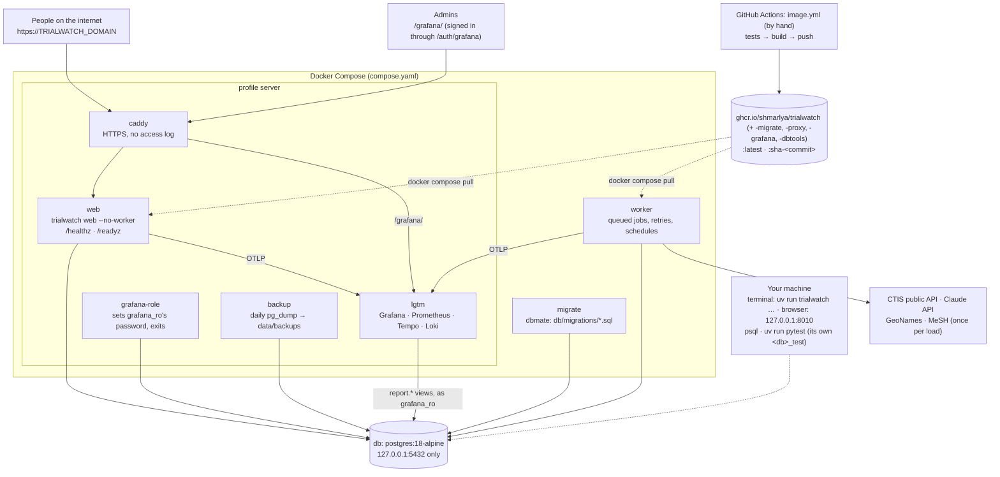
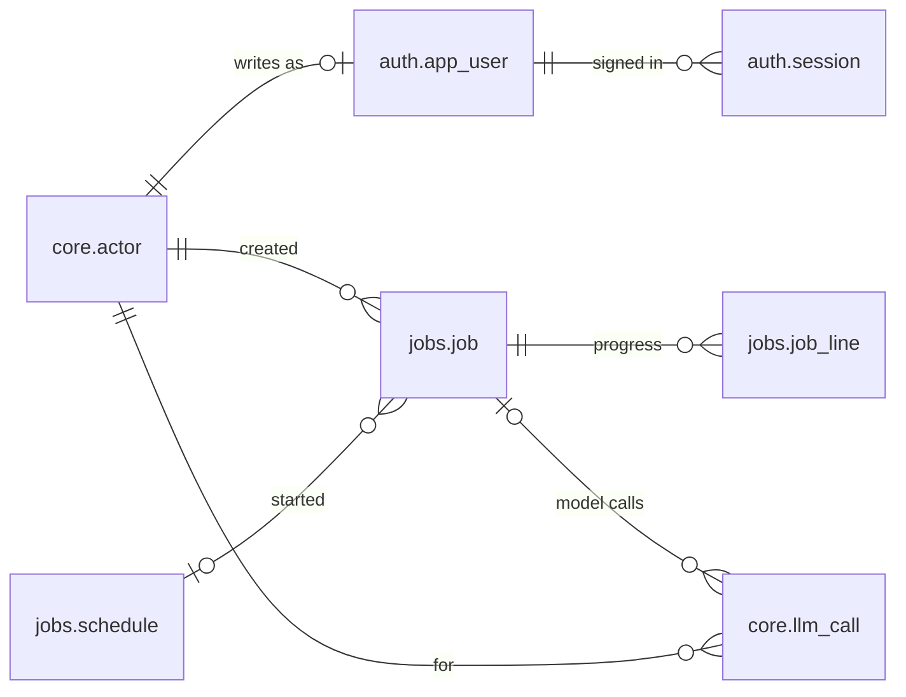

# Operations

How TrialWatch runs: the image, the Docker Compose stack, the web interface, jobs, spend, Grafana, backups, the
database, tests and CI.



## Running it

Copy `.env.example` to `.env` and set a password first. Every `trialwatch` command reads `.env`, so
`uv run trialwatch …` on this machine uses the same database as the containers. This starts the database and
applies the migrations:

```bash
docker compose run --rm migrate
```

`docker compose up -d` runs three services: `db` holds the data and is reachable from this machine only
(`127.0.0.1:5432`, volume `pgdata`, TimeZone UTC); `migrate` applies `db/migrations/*.sql` with dbmate and writes
`db/schema.sql`, then exits (the others start only if it succeeds; dbmate 2.37, `./db` mounted); `worker` runs
`trialwatch worker`. On this machine you run the site itself with `uv run trialwatch web` (below).

On a server, `docker compose --profile server up -d` also runs the site, Grafana and the backups:

- `web` runs `trialwatch web --host 0.0.0.0 --no-worker` in the image `ghcr.io/shmarlya/trialwatch` (Python 3.13,
  non-root, `ENTRYPOINT trialwatch`), with `data/` mounted read-only. Only
  `caddy` reaches it, so it trusts caddy's `X-Forwarded-*` headers (`FORWARDED_ALLOW_IPS`). Docker checks it with
  `/healthz` (the server is up; it asks nothing of the database); `/readyz` says whether the database answers and
  at which migration (503 when it doesn't).
- `caddy` serves HTTPS at `TRIALWATCH_DOMAIN` (in `.env`; a Let's Encrypt certificate, renewed by itself, kept in
  the volume `caddy-data`) and sends everything to `web` (`ops/caddy/Caddyfile`), `/grafana/` to `lgtm`. It keeps
  no access log: a search's address can be about someone's health, and `web` logs each request without its query
  string or the visitor's address.
- `lgtm` (`grafana/otel-lgtm`, pinned) is Grafana with Prometheus, Tempo and Loki, for admins
  ([below](#grafana)). No port of it is published.
- `grafana-role` gives `grafana_ro`, the database role Grafana reads with, its password, then exits.
- `backup` dumps the database every day ([below](#backups)).

To deploy: point the domain's DNS at the machine; copy `.env.example` to `.env` and set the passwords,
`TRIALWATCH_DOMAIN`, `TRIALWATCH_ADMIN_EMAIL`/`_PASSWORD` (the first admin), `OTEL_EXPORTER_OTLP_ENDPOINT=http://lgtm:4318`
and `GRAFANA_DB_PASSWORD`; then `docker compose pull && docker compose --profile server up -d`. Load the
reference data once (`geo load`, `vocab load`), switch the refresh's schedule on at `/admin/jobs`, and set a
spending cap at `/admin/spend`.

To update: run the **Image** workflow on `main` (Actions → Image → Run workflow, or
`gh workflow run image.yml --ref main`). It runs the tests, then pushes `ghcr.io/shmarlya/trialwatch` tagged
`sha-<commit>` and `latest`. On the server: `git pull` (for compose and `db/migrations`), then
`docker compose pull && docker compose --profile server up -d` (migrations run first). To roll back, set
`TRIALWATCH_TAG=sha-<commit>` in `.env` and run the same two commands. `up -d --build` builds from the checkout
instead.

One-off commands run in the same image: `docker compose run --rm web source list`.

## Coolify

[compose.coolify.yaml](https://github.com/shmarlya/trialwatch/blob/main/compose.coolify.yaml) is a smaller stack
for a host that has nothing of the repository, such as Coolify: the database, `web` and `worker`, nothing else.
Coolify does the rest: its proxy holds the certificate and sends plain HTTP to `web` on port 8010, it shows each
container's memory and CPU, and it backs the database up. `web` and `worker` run the app's image, which carries
the migrations and dbmate: each runs `dbmate --wait up` before it starts (a lock makes the second wait, then find
nothing to do). Every service has a memory and CPU limit (web 512 MB, worker 2 GB, db 768 MB; one CPU each;
the worker reads each PDF in a short-lived child process inside its 2 GB, see
[page text](sources-and-gold.md)),
so the stack needs about 3.3 GB beside Coolify's own. No Grafana here: compose.yaml has it, for a server of our own.

1. Run the **Image** workflow on `main`: it pushes the image.
2. In Coolify: **New resource → Docker Compose Empty**, and paste `compose.coolify.yaml`.
3. **Environment variables** (Coolify lists the ones the file uses):
   - required: `TRIALWATCH_DOMAIN` (e.g. `trialwatch.app`), `POSTGRES_PASSWORD`;
   - for sign-in: `TRIALWATCH_ADMIN_EMAIL`, `TRIALWATCH_ADMIN_PASSWORD` (the first admin, 12+ characters);
   - for checks and AI tags: `ANTHROPIC_API_KEY`;
   - optional: `TRIALWATCH_TAG` (default `latest`; `sha-<commit>` pins one), `POSTGRES_USER` and `POSTGRES_DB`
     (both `trialwatch`).
4. Give the **web** service the domain with its port, `https://trialwatch.app:8010` (the port tells Coolify's
   proxy where `web` listens; visitors still use plain `https://trialwatch.app`). Leave `worker` and `db` without
   one. DNS: an `A` record for the domain to the server.
5. Deploy.
6. Backups: the **db** service's **Backups** tab, a daily schedule to an S3 destination (Coolify's
   **S3 Storages**), so the copies leave the server.

To update: run the Image workflow, then **Redeploy** in Coolify (it pulls `latest`). To roll back, set
`TRIALWATCH_TAG=sha-<commit>` and redeploy (a migration is not undone: roll back only to an image whose migrations
the database already has). One-off commands: Coolify's terminal on the `web` container, e.g. `trialwatch geo load`.

## Web interface

```bash
uv run trialwatch web --reload
```

It opens on http://127.0.0.1:8010 and reads the database and `ANTHROPIC_API_KEY` from `.env`. On the Sources page,
sync a registered source's list, then transfer the evidence of the trials you tick or of all pending, failed or
stale ones, or add a trial by hand with uploaded PDFs; then run the evidence check. Each runs as a background job
with live progress. Staff browse every trial with its identifiers, documents and history (who added what, when),
each check's judgement with its step-by-step trace, and every run with its prompt and settings. The Gold page
searches the gold datasets ([sources and gold](sources-and-gold.md#gold-datasets)).

The site answers only requests addressed to this machine (127.0.0.1, localhost, ::1; `TRIALWATCH_HOSTS` adds other
names) and takes form posts only from its own pages. A stored PDF opens in the browser's viewer, sandboxed; any
other file is downloaded; uploads must be PDFs. Served on a network, it needs HTTPS in front (compose's `caddy`): off
this machine the session cookie is sent over HTTPS only.

The web server takes its database connections from a pool (`src/trialwatch/db/__init__.py`, opened when the server
starts); a connection goes back with its session reset, so a request never writes as the one before it or holds
its locks. The worker and the command line open a connection of their own each time.

### Sign-in and roles

Anyone not signed in sees the home page, the sign-in page, the published judgements with their trace
([checks](checks.md#publication)) and the pages of trials that recruit now ([search](search.md)). Everything else
needs a signed-in admin or moderator ([ADR-006](adr/ADR-006-auth-and-roles.md)). What each role may do is one chart,
`src/trialwatch/auth/actions.py`, shown at `/admin/roles`: moderators add trials, upload documents, edit sponsors,
transfer evidence, run dry-run checks, withdraw a judgement with a reason and stop their own jobs; only admins sync
and configure sources, run checks that call the model, stop other people's jobs, change schedules and the spending
cap, and manage users (`/admin/users`). The same rules hold for scripts calling the routes (401 when not signed in,
403 when the role may not), and writes are recorded as the signed-in person.

A browser gets an HTML page for an error (403, 404, 500); scripts get the plain or JSON answer. An error nobody
handled is logged by `trialwatch.web` with a short reference, and its page shows the same reference, so a person
reporting it can be matched to the log line.

People sign in with their email and a password (at least 12 characters). There is no sign-up. A session is a
random token in the HttpOnly, SameSite=Lax cookie `tw_session`, stored only as its SHA-256; it ends after 12 hours
unused, after 7 days, at sign-out, and when the user's role or password changes or they are disabled. The first
admin comes from `.env`: set `TRIALWATCH_ADMIN_EMAIL` and `TRIALWATCH_ADMIN_PASSWORD`, and `trialwatch web` adds
that admin when it starts, if no user has that email yet. It never changes an existing user, so changing the
password in `.env` later does nothing. Or add one from the terminal (it asks for the password):

```bash
uv run trialwatch user add you@example.org --role admin
```

`user list`, `user role EMAIL ROLE`, `user password EMAIL` and `user disable EMAIL` (`--enable` to undo) manage
them; the command line itself is not limited by roles, since it holds the database password.

## Jobs, the worker and the refresh

A form on the site does not run its step itself: it queues a job (`jobs.job`), and the worker runs the queued jobs
one at a time, each as whoever created it. `trialwatch web` starts a worker of its own as a child process, writing
to the same terminal, and stops it when the server stops (it doesn't restart with `--reload`: restart the server
to run changed job code). Where a worker runs separately (compose's `worker` service, another machine), start the
site with `--no-worker`, or leave it: several workers are safe, each takes a different job. A worker on its own:

```bash
uv run trialwatch worker
```

Every kind of job (sync, transfer, check, annotate, refresh) is one entry in `src/trialwatch/jobs/tasks.py`: its
label, how many attempts it gets, whether the spending cap holds it, how its params are checked when it is queued,
and the step that runs it. The commands `source sync`, `source transfer`, `search annotate` and `check evidence`
run the same steps here and now, without the queue. Jobs survive restarts. A failed attempt is tried again after 1 min, 5 min, 30 min,
2 h, 6 h (sync and transfer 5 attempts, the others 3); a retry redoes only what is left (the keys not transferred yet, the trials whose model call
failed for a passing reason such as an overload). An error that a retry can't fix (an unknown source, an invalid
setup, a bad API key) fails the job at once. A job whose worker died (no heartbeat for 5 minutes) goes back to the
queue. Jobs can be cancelled; a running one stops after the trial or page it is on, and what it did so far is kept.
`/admin/jobs` lists them by status, with the failed and held ones first (every staff page shows a banner while
there are any), their errors and their progress per attempt; an admin can try one again.

**Schedules** (`jobs.schedule`) start switched off: an admin starts or stops one and sets how often it runs (daily,
weekly or monthly, at an hour UTC) under Schedules on `/admin/jobs`; stopping one leaves a job it already started
running. The first is `weekly-refresh`, every Monday at 03:00 UTC by default (daily keeps the search's
"recruiting" fresher). It starts the **refresh**: one job that, step after step, syncs every switched-on source's
list, transfers the trials that are new, changed at the source (stale) or failed last time, recruiting ones first,
tags with AI the recruiting trials whose profile has no tags yet, then checks with the default setup the trials that
were never judged or whose judgement is outdated (`src/trialwatch/jobs/refresh.py`). Nothing changed, nothing is
checked and nothing is spent. A step that fails doesn't stop the others; the attempt fails and the next one carries
on from what is stored (a source synced in an earlier attempt isn't listed again). The spending cap holds the
refresh before its tagging and checking. While it runs, a job a person queues waits for it, unless a second worker
runs. Everything it does, and what TrialWatch publishes by itself, is recorded as the actor `trialwatch`
(`core.actor` 1), not as a person.

| Where | What |
|---|---|
| `web/app.py`, `web/deps.py`, `web/home.py` | the app (hosts, form origins, error pages, health) and what every route shares (templates, sign-in, the action guard, `with_error`); the home page, public or staff |
| `<part>/routes.py` | each part's pages and forms: `trials/`, `checks/`, `search/`, `gold/`, `sources/`, `jobs/` (queuing jobs, their live progress, schedules, spend), `auth/` (sign-in, users, the chart) |
| `web/templates/`, `web/static/` | pages, and the brand and UI components ([STYLE.md](../STYLE.md), UI) |
| `auth/` | accounts, passwords, sessions, the action chart |
| `jobs/tasks.py`, `worker.py`, `steps.py`, `refresh.py`, `retry.py` | every kind of job, the worker, what each kind does, the refresh, retries |
| `config.py` | every setting read from the environment (and `.env`) |
| `llm.py`, `prices.json` | every model call: the client, pricing per billed attempt, recording it as spend |
| `telemetry.py` | what TrialWatch records about itself for admins: traces, metrics, JSON logs, redaction ([below](#what-trialwatch-records-about-itself)) |
| `db/__init__.py` | connections: the web server's pool, everyone else's own |
| `db/overview.py`, `db/auth.py`, `db/jobs.py`, `db/costs.py` | their SQL |

## What TrialWatch records about itself

For admins, in Grafana (OpenTelemetry, `src/trialwatch/telemetry.py`). The web server and the worker send traces,
metrics and logs to `OTEL_EXPORTER_OTLP_ENDPOINT` (OTLP over HTTP) when it is set; without it nothing is sent and
recording costs next to nothing (the tests, the command line). Either way their logs are JSON lines on stderr
(time, level, logger, message, and the trace they were written in).

- **Traces**: every request (not `/healthz`, `/readyz`), with its database queries (SQL without parameters) and
  outgoing HTTP calls; and the work: `jobs.run` (one job attempt; the job's page shows its trace id), `ingest.trial`
  (one trial transferred), `checks.trial` (one trial checked), `llm.call` (one model call), `search.find` (one
  search: counts only). An unhandled error's page shows its trace id as the reference to search for.
- **Metrics**: `trialwatch.llm.calls`, `.tokens`, `.cost`, `.duration` (by model, operation, outcome);
  `trialwatch.search.requests`, `.duration` (by outcome: hits, empty, error); `trialwatch.source.fetches` (by
  source, outcome: ok, not_found, error); `trialwatch.jobs.finished`, `.duration` (by kind, status); and
  `trialwatch.worker.heartbeat` (when the worker last said it is alive). The queue, spend and judgements are read
  from Postgres, not counted twice.
- **Privacy** (ADR-008): what someone searched for is recorded nowhere. Every span is redacted before it leaves the
  process: no query string (`url.query`, `url.full`, `http.target`, `http.url`) and no visitor's address
  (`net.peer.ip`, `client.address`, …), and on `/find` an error keeps its type only, not its message or traceback;
  access log lines leave out query strings and the visitor's address; libraries that log whole
  addresses (`httpx`, `httpx2`) log warnings only. `tests/test_telemetry.py` searches with a marker word and checks
  it appears in no span, event, metric or log.
- **The worker's heartbeat**: it touches `TRIALWATCH_HEARTBEAT_FILE` (default `/tmp/trialwatch-worker.alive`) every
  loop and every 30 seconds while a job runs; compose's healthcheck reads its age.

## Grafana

Admins open `https://TRIALWATCH_DOMAIN/grafana/`, signed in through TrialWatch: before each request caddy asks
`web` who is signed in (`/auth/grafana`: an admin's email in `X-WEBAUTH-USER`; someone not signed in goes to the
sign-in page first; anyone else is refused), and Grafana believes that header and nothing else (auth proxy; its own
login form and anonymous access are off; caddy drops the header from a browser). Only admins have the action
`ops.view`; moderators see `/admin/jobs` and `/admin/spend` but not Grafana.

### Opening it

Grafana runs only in the server setup; `uv run trialwatch web` alone has none.

1. In `.env`: `OTEL_EXPORTER_OTLP_ENDPOINT=http://lgtm:4318` and a `GRAFANA_DB_PASSWORD`. On your own machine
   leave `TRIALWATCH_DOMAIN` empty: caddy then serves `https://localhost` with a certificate of its own (the
   browser warns once).
2. `docker compose --profile server up -d`.
3. Sign in to TrialWatch as an admin (`https://<domain>/login`), then click **Grafana** in the menu, or open
   `https://<domain>/grafana/`. Dashboards → folder **TrialWatch**.

Only the `web` and `worker` containers send telemetry there: a `uv run trialwatch web` on the host does not reach
`lgtm` (no port of it is published).

### What to watch

Once a day, or when an alert fires.

| Dashboard | Look at | Worry when |
|---|---|---|
| **Jobs** | Worker's last heartbeat; Failed, held, or queued over an hour | heartbeat over 5 minutes; any row in the table (retry or cancel it on `/admin/jobs`) |
| **Spend** | This month; Of the monthly cap; Costliest check runs | the cap above 80% (at 100% automatic checks and tags stop); one run costing far more than the others |
| **HTTP** | Requests by status; 95th percentile latency by route; Warnings and errors | any 5xx (over 1% for 10 minutes alerts); a route over about 1 s; new error lines (each opens its trace) |
| **Checks** | Judgements per day by label; Measured agreement with gold labels; Model calls by outcome | agreement dropping after a prompt, model or requirement change; model calls failing; no judgements after a refresh |
| **Sources** | Sources (last sync, last transfer, failed transfers); Records fetched by outcome | last sync older than the schedule (a week); failed transfers or fetch errors growing (CTIS changed or is down) |
| **Search** | Searches by outcome; Found nothing, last 24 hours; duration | errors; the share finding nothing rising; 95th percentile over about 1 s |

To follow one slow page or failed job: **Explore** → Tempo, search by trace id (a job's page links its own; an
error page shows its id), or Loki for its log lines.

### What is there

- **Dashboards** (folder TrialWatch, `ops/grafana/dashboards/`, changed only there): HTTP (requests, server
  errors, latency by route, warning and error logs), Jobs (heartbeat, queue, attempts, durations, what waits for a
  person), Spend (this month and the cap, per day by model and operation, the costliest runs), Checks (judgements by
  label, agreement with gold, model calls), Sources (freshness, fetches, runs), Search (searches by outcome, empty
  share, duration). Explore searches traces (Tempo) and logs (Loki); a job's page links its trace.
- **Alerts** (`ops/grafana/provisioning/alerting/trialwatch.yaml`): the worker stopped (no heartbeat for 5
  minutes), a job failed or is held, a job waits over an hour, spend at 80% of the cap, more than 1% server errors
  over 10 minutes, the web server sends nothing, the database does not answer, no backup in 26 hours. They show in
  Grafana's Alerting page; to be told, give Grafana a contact point (`GF_SMTP_*` settings in compose, or one added
  there).
- **Postgres** is read through the `report` schema's views only (queue, spend, checks, sources, backups), by
  `grafana_ro`, which can read nothing else: no person's name or email, no session, no model request or answer, no
  document. Latency, errors and searches come from the metrics.
- **Kept**: metrics 90 days, logs 30, traces 7 (`ops/lgtm/`, volume `lgtm-data`); jobs' progress lines 90 days after
  they end, and ended sign-in sessions not at all (the worker, daily). Business data is kept.

## Backups

`backup` runs `pg_dump -Fc` into `./data/backups/` when it starts and then every day, keeps 14 days
(`BACKUP_KEEP_DAYS`), and records each in `core.backup` (an alert fires when the newest is 26 hours old). Copy
`./data/backups/` off the machine from the host, e.g. with `restic` or `rclone` in a nightly cron. To restore
one: stop `web`, `worker` and `backup`, then
`docker compose exec -T db pg_restore -U <user> -d <database> --clean --if-exists < data/backups/<file>.dump`,
and start them again.

## Spend

Every model call is one row in `core.llm_call`, kept once: the request as sent and the answer (a check's trace
and an AI tagging name it), and each billed attempt with its tokens and its cost in US dollars, priced at
Anthropic's list prices in `src/trialwatch/prices.json` (each attempt keeps the prices it was charged at; a model
missing from the list is shown as unpriced, never as $0; a new model needs a price before it runs). Runs,
judgements, trace steps and jobs show their cost to staff, and `/admin/spend` shows the totals: this month, the
last 30 days, all time, by month, model, operation and actor, and the costliest runs. An admin sets a monthly cap
there (`core.app_setting`): once this month's spend reaches it, the refresh's checks and tags are held, not failed (they go on by themselves next month or when the cap is raised); checks a person starts always
run. The gold evaluation reports show the cost too.

## Database

Postgres 18 in Docker Compose. The migrations in `db/migrations/` are applied in order, and `db/schema.sql` is the
schema they make (generated; the migrations are the source of truth, and `db/schema.sql` lists every column). All times are `timestamptz`; the database and
every app session use TimeZone UTC. All SQL lives in `src/trialwatch/db/` (psycopg 3) (`tests/test_sql_lives_in_db.py` fails
if SQL appears anywhere else): `connect()` opens a connection in UTC and names who is writing; one module per
schema, and `db/overview.py` for the web interface's read-only pages.

Everything up to 2026-11-23 is one migration, `db/migrations/20261121120000_init.sql`, organised by schema. It
keeps the version the first squash had, and the schema it makes is the one the sixteen earlier migrations made
(checked by dumping a database built each way), so a database made with those keeps its data: delete the later
versions from `public.schema_migrations` and nothing else (`DELETE FROM public.schema_migrations WHERE version >
'20261121120000'`). New changes get new files; they are folded into the init again before the first deploy.

The tables are described with each part: [sources and gold](sources-and-gold.md#central-model-tables) (`core`),
[checks](checks.md#tables) (`checks`), [search](search.md#tables) (`search`, `geo`, `vocab`). Sign-in, jobs and
spend:



| Table | What it holds |
|---|---|
| `auth.app_user` | a person who can sign in: email (unique, lower case), argon2id password hash (left out of the audit log), role (admin, moderator), their `core.actor`, disabled_at |
| `auth.session` | a signed-in browser: the SHA-256 of the cookie's token (the token isn't kept), user, last seen, expiry |
| `jobs.job` | one job: kind (sync, transfer, check, annotate, refresh), params, automatic (the cap applies), schedule, priority, status (queued, running, held, succeeded, failed, cancelled), attempts and retries, the worker on it and its heartbeat |
| `jobs.job_line` | a job's progress lines, per attempt |
| `jobs.schedule` | when a job starts by itself: name, kind and params, frequency (daily, weekly, monthly), weekday, hour UTC, enabled, next run |
| `core.llm_call` | every model call, one row each, failed ones too: model asked and model that answered, operation (check, annotate), run, trial, call number, job, the request as sent (no system prompt; files by sha256), the answer, stop reason, latency, error, the provider's request id, and each billed attempt priced (more than one after a fallback) with their sums: tokens, cost, attempts on an unpriced model |
| `core.app_setting` | settings an admin changes (audited): `spend.monthly_cap_usd` |
| `core.backup` | each nightly backup: file, size in bytes, when ([backups](#backups)) |
| `report.*` | views Grafana reads as `grafana_ro`: jobs, llm_calls, spend, spend_cap, check_runs, judgements, ingest_runs, sources, backups |
| `public.schema_migrations` | dbmate's own table: which migrations are applied |

`checks.run` and `core.ingest_run` also have a `job_id`.

## Tests and CI

The tests never touch the working database: `tests/conftest.py` makes `<database>_test` on the same server from the
migrations for every run, and CTIS and the model are faked. Without a reachable server the database tests are
skipped.

```bash
uv run pytest
```

GitHub Actions:

- `.github/workflows/tests.yml`, on every push and pull request: ruff (`ruff check`, `ruff format --check`) and
  the whole test suite, against a Postgres service of its own.
- `.github/workflows/docs.yml`, on every push and pull request: a strict build of this site; pushes to `main` also
  publish it to GitHub Pages.
- `.github/workflows/image.yml`, started by hand: the tests, then the image to `ghcr.io/shmarlya/trialwatch`
  (`sha-<commit>`, and `latest` from `main`).
- Started by hand, calling CTIS or the model: `eval-short.yml` and `eval-full.yml` (gold evaluations, sharing
  `eval-shared.yml`) and `gold-snapshot.yml` (records the frozen snapshot); see
  [gold evaluations](sources-and-gold.md#gold-evaluations-ci).

## Code style

The rules are in [STYLE.md](../STYLE.md): code as simple as possible. Ruff checks what a tool can
(`pyproject.toml`); the pre-commit hook runs it before each commit. One-time setup:

```bash
uv run pre-commit install
```

```bash
uv run ruff check
```

```bash
uv run ruff format --check
```

Files written before ruff are listed under `[tool.ruff.format] exclude` in `pyproject.toml`; each is formatted, and
leaves the list, in the refactor that rewrites it.

## Docs

The docs are markdown: [README.md](../README.md), the pages in `docs/`, the [glossary](glossary.md) and the
decisions in `docs/adr/`. Diagrams are Mermaid, drawn by GitHub and by the docs site. The site is built by MkDocs
Material (`mkdocs.yml`; `tools/site_hooks.py` adds README.md, STYLE.md and the benchmark data's README as pages, and
sends links to the decisions, which stay in the repo only, to GitHub). Every push to `main` publishes it to
https://shmarlya.github.io/trialwatch/. Preview it locally at http://127.0.0.1:8000/trialwatch/ with:

```bash
uv run --group docs mkdocs serve
```

## Runbook

- **A job failed.** `/admin/jobs` shows its error and progress per attempt. From the terminal:
  `uv run trialwatch jobs list --status failed`, then `uv run trialwatch jobs retry N`.
- **Run the refresh now.** `uv run trialwatch jobs refresh` queues one.
- **Checks are held.** This month's spend reached the cap on `/admin/spend`: raise it, or wait for next month.
- **Locked out.** `uv run trialwatch user password EMAIL`, or `user add` a new admin.
- **Someone reports an error page.** Its reference is the request's trace id: Grafana's Explore, Tempo, finds the
  trace, and Loki the log line (`unhandled error, reference …`).
- **An alert fired.** Its description says where to look; the dashboards of the same name show what led up to it.
- **The worker stopped.** `docker compose ps worker`, `docker compose logs worker`; `docker compose up -d worker`.
  A job it was running goes back to the queue once its heartbeat lapses.
- **Reset the database** (until the first deploy): back it up first (on a server the newest file in
  `data/backups/`; elsewhere `docker compose exec db pg_dump -U <user> -Fc <database> > data/backups/<date>.dump`), then
  `docker compose down -v` and `docker compose run --rm migrate`, and reload: `geo load`, `vocab load`,
  `source sync ctis`, `source transfer ctis --which recruiting`, `search annotate`, `check evidence`.
