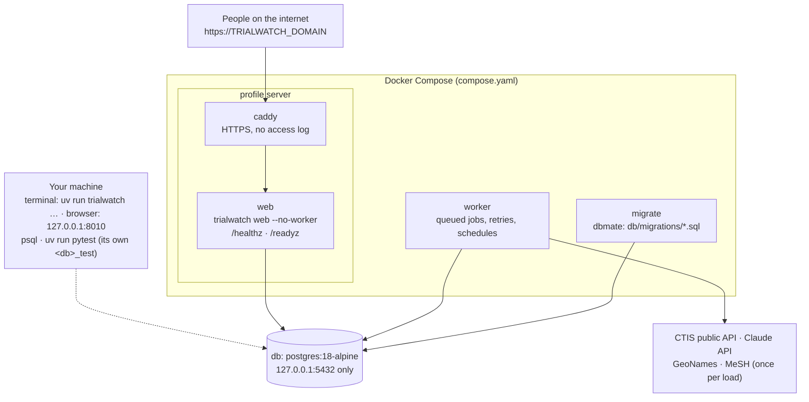
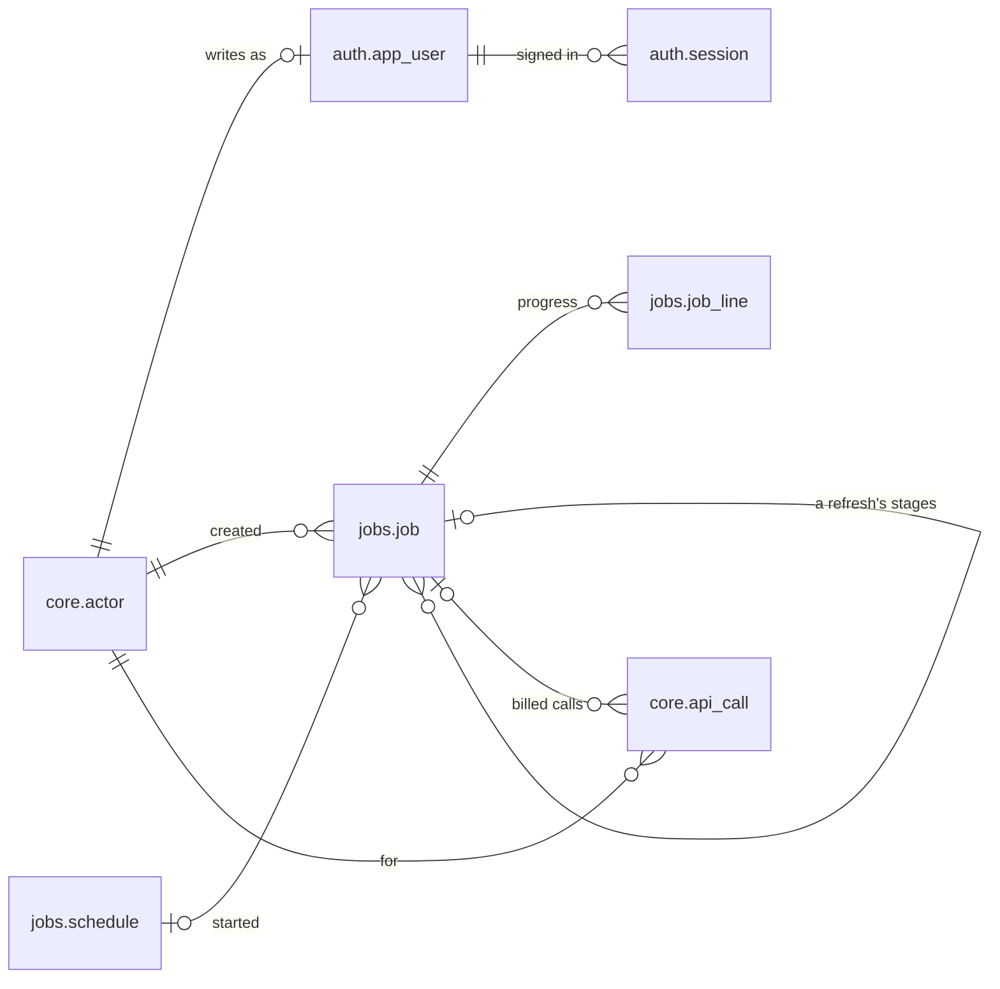

# Operations

How TrialWatch runs: the Docker Compose stack, the web interface, jobs, spend, the database, tests and CI. Nothing
runs in production yet; monitoring (Grafana) and backups are not set up.



## Running it

Copy `.env.example` to `.env` and set a password first. Every `trialwatch` command reads `.env`, so
`uv run trialwatch …` on this machine uses the same database as the containers. This starts the database and
applies the migrations:

```bash
docker compose run --rm migrate
```

`docker compose up -d` runs three services: `db` holds the data and is reachable from this machine only
(`127.0.0.1:5432`, volume `pgdata`, TimeZone UTC); `migrate` applies `db/migrations/*.sql` with dbmate and writes
`db/schema.sql`, then exits (the others start only if it succeeds; dbmate 2.37, `./db` mounted); `worker` runs
`trialwatch worker`. On this machine you run the site itself with `uv run trialwatch web` (below).

On a server, `docker compose --profile server up -d` also runs the site:

- `web` runs `trialwatch web --host 0.0.0.0 --no-worker` in the image `trialwatch:dev` (Python 3.13, non-root,
  `ENTRYPOINT trialwatch`), with `data/` mounted read-only (and `data/ctis/` writable for `--files-dir`). Only
  `caddy` reaches it, so it trusts caddy's `X-Forwarded-*` headers (`FORWARDED_ALLOW_IPS`). Docker checks it with
  `/healthz` (the server is up; it asks nothing of the database); `/readyz` says whether the database answers and
  at which migration (503 when it doesn't).
- `caddy` serves HTTPS at `TRIALWATCH_DOMAIN` (in `.env`; a Let's Encrypt certificate, renewed by itself, kept in
  the volume `caddy-data`) and sends everything to `web` (`ops/caddy/Caddyfile`). It keeps no access log: a search's
  address can be about someone's health, and `web` logs each request without its query string.

One-off commands run in the same image: `docker compose run --rm web source list`.

## Web interface

```bash
uv run trialwatch web --reload
```

It opens on http://127.0.0.1:8010 and reads the database and `ANTHROPIC_API_KEY` from `.env`. On the Sources page,
sync a registered source's list, then transfer the evidence of the trials you tick or of all pending, failed or
stale ones, or add a trial by hand with uploaded PDFs; then run the evidence check. Each runs as a background job
with live progress. Staff browse every trial with its identifiers, documents and history (who added what, when),
each check's judgement with its step-by-step trace, and every run with its prompt and settings. The Gold page
searches the gold datasets ([sources and gold](sources-and-gold.md#gold-datasets)).

The site answers only requests addressed to this machine (127.0.0.1, localhost, ::1; `TRIALWATCH_HOSTS` adds other
names) and takes form posts only from its own pages. A stored PDF opens in the browser's viewer, sandboxed; any
other file is downloaded; uploads must be PDFs. Served on a network, it needs HTTPS in front (compose's `caddy`): off
this machine the session cookie is sent over HTTPS only.

The web server takes its database connections from a pool (`src/trialwatch/db/__init__.py`, opened when the server
starts); a connection goes back with its session reset, so a request never writes as the one before it or holds
its locks. The worker and the command line open a connection of their own each time.

### Sign-in and roles

Anyone not signed in sees the home page, the sign-in page, the published judgements with their trace
([checks](checks.md#publication)) and the pages of trials that recruit now ([search](search.md)). Everything else
needs a signed-in admin or moderator ([ADR-006](adr/ADR-006-auth-and-roles.md)). What each role may do is one chart,
`src/trialwatch/auth/actions.py`, shown at `/admin/roles`: moderators add trials, upload documents, edit sponsors,
transfer evidence, run dry-run checks, withdraw a judgement with a reason and stop their own jobs; only admins sync
and configure sources, run checks that call the model, stop other people's jobs, change schedules and the spending
cap, and manage users (`/admin/users`). The same rules hold for scripts calling the routes (401 when not signed in,
403 when the role may not), and writes are recorded as the signed-in person.

A browser gets an HTML page for an error (403, 404, 500); scripts get the plain or JSON answer. An error nobody
handled is logged by `trialwatch.web` with a short reference, and its page shows the same reference, so a person
reporting it can be matched to the log line.

People sign in with their email and a password (at least 12 characters). There is no sign-up. A session is a
random token in the HttpOnly, SameSite=Lax cookie `tw_session`, stored only as its SHA-256; it ends after 12 hours
unused, after 7 days, at sign-out, and when the user's role or password changes or they are disabled. The first
admin comes from `.env`: set `TRIALWATCH_ADMIN_EMAIL` and `TRIALWATCH_ADMIN_PASSWORD`, and `trialwatch web` adds
that admin when it starts, if no user has that email yet. It never changes an existing user, so changing the
password in `.env` later does nothing. Or add one from the terminal (it asks for the password):

```bash
uv run trialwatch user add you@example.org --role admin
```

`user list`, `user role EMAIL ROLE`, `user password EMAIL` and `user disable EMAIL` (`--enable` to undo) manage
them; the command line itself is not limited by roles, since it holds the database password.

## Jobs, the worker and the weekly refresh

A form on the site does not run its step itself: it queues a job (`jobs.job`), and the worker runs the queued jobs
one at a time, each as whoever created it. `trialwatch web` starts a worker of its own as a child process, writing
to the same terminal, and stops it when the server stops (it doesn't restart with `--reload`: restart the server
to run changed job code). Where a worker runs separately (compose's `worker` service, another machine), start the
site with `--no-worker`, or leave it: several workers are safe, each takes a different job. A worker on its own:

```bash
uv run trialwatch worker
```

Jobs survive restarts. A failed attempt is tried again after 1 min, 5 min, 30 min, 2 h, 6 h (sync and transfer 5
attempts, a check 3); a retry redoes only what is left (the keys not transferred yet, the trials whose model call
failed for a passing reason such as an overload). An error that a retry can't fix (an unknown source, an invalid
setup, a bad API key) fails the job at once. A job whose worker died (no heartbeat for 5 minutes) goes back to the
queue. Jobs can be cancelled; a running one stops after the trial or page it is on, and what it did so far is kept.
`/admin/jobs` lists them by status, with the failed and held ones first (every staff page shows a banner while
there are any), their errors and their progress per attempt; an admin can try one again.

**Schedules** (`jobs.schedule`) start switched off: an admin starts or stops one and sets how often it runs (daily,
weekly or monthly, at an hour UTC) under Schedules on `/admin/jobs`; stopping one leaves a job it already started
running. The first is `weekly-refresh`, every Monday at 03:00 UTC by default (daily keeps the search's
"recruiting" fresher). It syncs every switched-on source's list, transfers the trials that are new, changed at the
source (stale) or failed last time, in batches of 50, recruiting ones first, then tags with AI the recruiting
trials whose profile has no tags yet (the `annotate` job, in batches of 50, held by the spending cap like checks),
then checks, in batches of 20 with the default setup, the trials that were never judged or whose judgement is
outdated (`src/trialwatch/jobs/refresh.py`). Nothing changed, nothing is checked and nothing is spent. Everything
it does, and what TrialWatch publishes by itself, is recorded as the actor `trialwatch` (`core.actor` 1), not as a
person.

| Where | What |
|---|---|
| `web/app.py`, `web/jobs.py` | the web interface's routes; queuing jobs and their live progress |
| `web/templates/`, `web/static/` | pages, and the brand and UI components ([STYLE.md](../STYLE.md), UI) |
| `auth/` | accounts, passwords, sessions, the action chart |
| `jobs/worker.py`, `steps.py`, `refresh.py`, `retry.py` | the worker, what each job kind does, the refresh, retries |
| `config.py` | every setting read from the environment (and `.env`) |
| `llm.py`, `prices.json` | every model call: the client, pricing per billed attempt, recording it as spend |
| `telemetry.py` | traces and counters for admins (OpenTelemetry; recorded nowhere until Grafana is set up) |
| `db/__init__.py` | connections: the web server's pool, everyone else's own |
| `db/overview.py`, `db/auth.py`, `db/jobs.py`, `db/costs.py` | their SQL |

## Spend

Every billed model call is a row in `core.api_call` with its tokens and its cost in US dollars, priced at
Anthropic's list prices in `src/trialwatch/prices.json` (each row keeps the prices it was charged at; a model
missing from the list is shown as unpriced, never as $0; a new model needs a price before it runs). Runs,
judgements, trace steps and jobs show their cost to staff, and `/admin/spend` shows the totals: this month, the
last 30 days, all time, by month, model, operation and actor, and the costliest runs. An admin sets a monthly cap
there (`core.app_setting`): once this month's spend reaches it, the automatic checks and tags of the weekly refresh
are held, not failed (they go on by themselves next month or when the cap is raised); checks a person starts always
run. The gold evaluation reports show the cost too.

## Database

Postgres 18 in Docker Compose. The migrations in `db/migrations/` are applied in order, and `db/schema.sql` is the
schema they make (generated; the migrations are the source of truth, and `db/schema.sql` lists every column). All times are `timestamptz`; the database and
every app session use TimeZone UTC. All SQL lives in `src/trialwatch/db/` (psycopg 3) (`tests/test_sql_lives_in_db.py` fails
if SQL appears anywhere else): `connect()` opens a connection in UTC and names who is writing; one module per
schema, and `db/overview.py` for the web interface's read-only pages.

Everything up to 2026-11-23 is one migration, `db/migrations/20261121120000_init.sql`, organised by schema. It
keeps the version the first squash had, and the schema it makes is the one the sixteen earlier migrations made
(checked by dumping a database built each way), so a database made with those keeps its data: delete the later
versions from `public.schema_migrations` and nothing else (`DELETE FROM public.schema_migrations WHERE version >
'20261121120000'`). New changes get new files; they are folded into the init again before the first deploy.

The tables are described with each part: [sources and gold](sources-and-gold.md#central-model-tables) (`core`),
[checks](checks.md#tables) (`checks`), [search](search.md#tables) (`search`, `geo`, `vocab`). Sign-in, jobs and
spend:



| Table | What it holds |
|---|---|
| `auth.app_user` | a person who can sign in: email (unique, lower case), argon2id password hash (left out of the audit log), role (admin, moderator), their `core.actor`, disabled_at |
| `auth.session` | a signed-in browser: the SHA-256 of the cookie's token (the token isn't kept), user, last seen, expiry |
| `jobs.job` | one job: kind (sync, transfer, check, annotate, refresh), params, automatic (the cap applies), parent and schedule, priority, status (queued, running, waiting, held, succeeded, failed, cancelled), attempts and retries, the worker on it and its heartbeat |
| `jobs.job_line` | a job's progress lines, per attempt |
| `jobs.schedule` | when a job starts by itself: name, kind and params, frequency (daily, weekly, monthly), weekday, hour UTC, enabled, next run |
| `core.api_call` | every billed call to a paid API: model, operation (check, annotate), run, trial, job, tokens, cost, the prices charged, the provider's request id |
| `core.app_setting` | settings an admin changes (audited): `spend.monthly_cap_usd` |
| `public.schema_migrations` | dbmate's own table: which migrations are applied |

`checks.run` and `core.ingest_run` also have a `job_id`.

## Tests and CI

The tests never touch the working database: `tests/conftest.py` makes `<database>_test` on the same server from the
migrations for every run, and CTIS and the model are faked. Without a reachable server the database tests are
skipped.

```bash
uv run pytest
```

GitHub Actions:

- `.github/workflows/tests.yml`, on every push and pull request: ruff (`ruff check`, `ruff format --check`) and
  the whole test suite, against a Postgres service of its own.
- `.github/workflows/docs.yml`, on every push and pull request: a strict build of this site; pushes to `main` also
  publish it to GitHub Pages.
- Started by hand, calling CTIS or the model: `eval-short.yml` and `eval-full.yml` (gold evaluations, sharing
  `eval-shared.yml`) and `gold-snapshot.yml` (records the frozen snapshot); see
  [gold evaluations](sources-and-gold.md#gold-evaluations-ci).

## Code style

The rules are in [STYLE.md](../STYLE.md): plain code for readers who don't read Python. Ruff checks what a tool can
(`pyproject.toml`); the pre-commit hook runs it before each commit. One-time setup:

```bash
uv run pre-commit install
```

```bash
uv run ruff check
```

```bash
uv run ruff format --check
```

Files written before ruff are listed under `[tool.ruff.format] exclude` in `pyproject.toml`; each is formatted, and
leaves the list, in the refactor that rewrites it.

## Docs

The docs are markdown: [README.md](../README.md), the pages in `docs/`, the [glossary](glossary.md) and the
decisions in `docs/adr/`. Diagrams are Mermaid, drawn by GitHub and by the docs site. The site is built by MkDocs
Material (`mkdocs.yml`; `tools/site_hooks.py` adds README.md, STYLE.md and the benchmark data's README as pages, and
sends links to the decisions, which stay in the repo only, to GitHub). Every push to `main` publishes it to
https://shmarlya.github.io/trialwatch/. Preview it locally at http://127.0.0.1:8000/trialwatch/ with:

```bash
uv run --group docs mkdocs serve
```

## Runbook

- **A job failed.** `/admin/jobs` shows its error and progress per attempt. From the terminal:
  `uv run trialwatch jobs list --status failed`, then `uv run trialwatch jobs retry N`.
- **Run the refresh now.** `uv run trialwatch jobs refresh` queues one.
- **Checks are held.** This month's spend reached the cap on `/admin/spend`: raise it, or wait for next month.
- **Locked out.** `uv run trialwatch user password EMAIL`, or `user add` a new admin.
- **Someone reports an error page.** Search the web log for the reference it shows (`unhandled error, reference
  …`).
- **Reset the database** (until the first deploy): back it up first with
  `docker compose exec db pg_dump -U <user> -Fc <database> > data/backups/<date>.dump`, then
  `docker compose down -v` and `docker compose run --rm migrate`, and reload: `geo load`, `vocab load`,
  `source sync ctis`, `source transfer ctis --which recruiting`, `search annotate`, `check evidence`.
