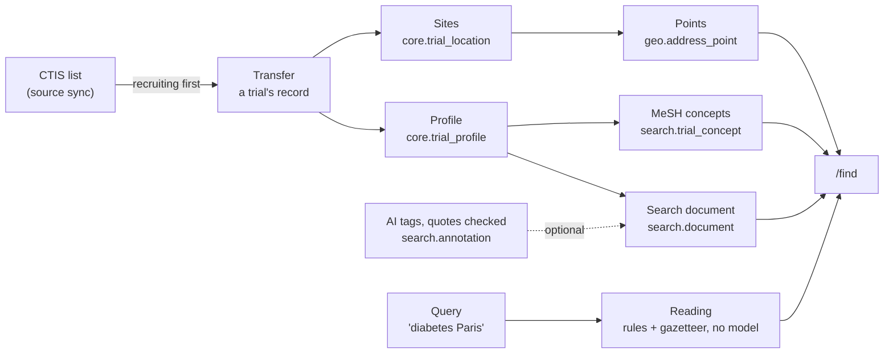
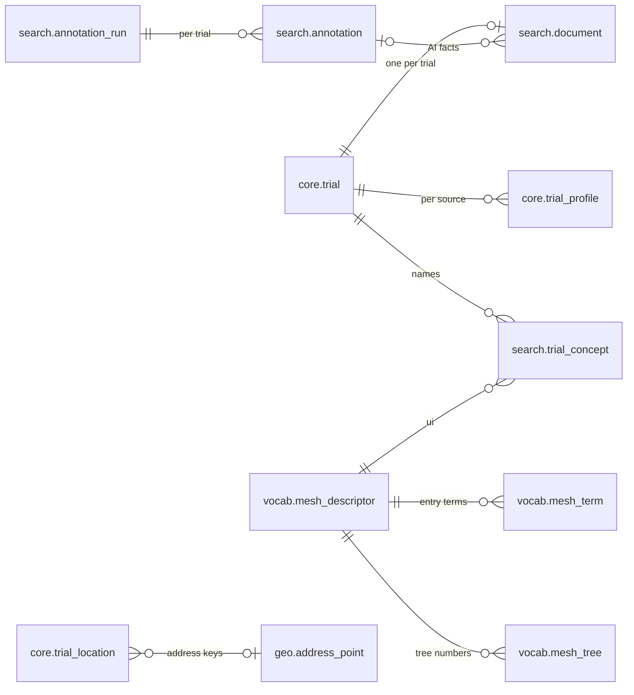

# Patient search

`/find` searches the trials that recruit now, for anyone ([ADR-008](adr/ADR-008-patient-search.md)). A person types
a condition and a place, in any EU language ("diabetes Paris", "cancer du sein Lyon", "healthy volunteers
Berlin", "asthma 28046"), and gets the trials recruiting near it, nearest site and distance first. The home page
has the same box.



## How it works

- **Every trial's record, recruiting ones first.** A sync marks the trials CTIS's list calls recruiting (overall
  status 3 or 4, in `core.source_listing.recruiting`); transfers take them first (`source transfer ctis --which
  recruiting`, and the refresh). Each transfer reads the trial's **profile** from its record
  (`src/trialwatch/sources/profile.py`, `core.trial_profile`: conditions with their translations, the MedDRA terms
  CTIS publishes, MeSH areas, phase, ages, sex, patients or healthy volunteers, criteria, products, status and
  recruitment dates per country; never people), finds where its new sites are, and builds its **search document**
  (`search.document`), so a trial is findable the moment it arrives. `source profiles ctis` and `search reindex`
  rebuild them from stored records, fetching nothing.
- **Any source.** The profile is one shape for every registry. A trial held by several sources is one profile for
  search (`profile.current`): lists joined, each item once (a country once, as the newest source gives it), single
  values from the newest source that gives one, recruiting when any source says it recruits now; a trial held by
  one source is its profile as it is. Countries are compared by ISO code (`src/trialwatch/geo/countries.py`), so two
  registries spelling a country differently meet: `search.document.recruiting_countries` and
  `core.trial_location.country_iso2` hold codes, pages show names. A source may also give a site's point (used as
  is), its conditions coded in MeSH (taken as concepts as they are, method `source-code`) and exact age limits
  (`age_min`, `age_max`; preferred to the ones AI tags quote). CTIS gives none of these three.
- **Words, weighted.** A: conditions, their translations, MedDRA names, AI synonyms; B: titles; C: products and
  objective; D: inclusion criteria. Exclusion criteria are never indexed. Words match without accents and by their
  beginning ("diabète", "diabet…").
- **Concepts.** MeSH (U.S. National Library of Medicine) gives each disease its synonyms, many in lay words
  ("heart attack", "high blood pressure"), and its place in a hierarchy. A trial's conditions are matched to MeSH
  without AI (`search.trial_concept`, with the words they were found in), and its document carries the concept and
  every one above it, so "diabetes" finds a trial filed as "NIDDM". `trialwatch vocab load` loads MeSH's diseases
  and mental disorders.
- **Places.** GeoNames (CC BY 4.0) gives every place with 1000+ people of the countries search covers
  (`TRIALWATCH_COUNTRIES`, by default the EU/EEA, where CTIS trials have sites), its names in many languages (Wien,
  Vienna, Vienne) and postal codes with a point; `trialwatch geo load` loads it (Greece has no postal code file),
  `geo geocode` finds each site's point (by postcode, else city name, else a city named alike; it prints the ones
  not found), `geo find NAME` shows what a name means. A place in a query is a distance: "Paris" finds the site in
  Villejuif.
- **Reading a query, without a model.** Rules and the gazetteer take out an age ("45 ans"), a phase, words for
  children, older people, women, men, healthy volunteers, a country, a postcode and a place (from the end of the
  query; a small place only after "near", "à", "bei"…), and read the rest as the condition
  (`src/trialwatch/search/query.py`, `lexicon.json`, `categories.json`). The page shows the reading ("diabetes ·
  near Paris, France · within 50 km") with a form to change it, other readings as links, counts at each distance,
  and "did you mean" when a word is in no recruiting trial.
- **AI tags, each with a checked quote.** `trialwatch search annotate` (and the refresh) has a model
  (`search/configs/annotate.json`, prompt `checks/prompts/annotate.md`) tag each recruiting trial: categories, the
  kind of medicine, the purpose, synonyms of its conditions in English and its countries' languages, MeSH concepts
  from a shortlist, and the age limits its inclusion criteria give. A tag is kept only if it quotes the field it
  names, word for word; the others are kept as dropped, with why. Tags are shown as AI-made with their quote; each
  call is a priced `core.api_call` row (operation `annotate`). About $0.001 a trial. Search works fully without
  them.
- **Private.** What someone searches for can be about their health: nothing about a search is stored, a Referer
  never carries a page's address, only the site's origin (`Referrer-Policy: strict-origin`), and links to CTIS
  send none (`rel="noreferrer"`), so a link out doesn't reveal the search. Not `no-referrer`: under it, browsers
  send `Origin: null` when our own pages post a form, and the form check refuses it. `/find` is `no-store` and
  `noindex`, `trialwatch web` logs requests without their query string (`src/trialwatch/web/privacy.py`), and an
  error on `/find` is logged without its message, which could quote the search. A reverse proxy in front must
  leave query strings out of its logs too.

A trial's status is CTIS's, per country; a card says when the register last changed the trial. Every search and
recruiting trial page says it is not medical advice and that the trial's team decides who can take part. The page
of a trial that recruits now is public whether or not it has a judgement (`view.recruiting`).

**Measuring it.** `trialwatch search eval` reads the queries of `evals/search-queries.json` (45 in eight
languages: a condition and a place, lay words, drug names, misspellings, abbreviations, healthy volunteers,
children, ages, postcodes, countries, ambiguous names), says which were read differently from how they should be,
and counts what each finds near the place, in its country and anywhere, next to plain text matching on CTIS's
list (each word in the listed conditions or title): what CTIS's own search would find. It calls no model. Which
trials are relevant to each query (recall, nDCG) needs judged trials, which are not there yet.

## Setting it up

```bash
uv run trialwatch geo load
```

```bash
uv run trialwatch vocab load
```

```bash
uv run trialwatch source transfer ctis --which recruiting
```

```bash
uv run trialwatch search annotate --all --limit 20
```

Other commands: `source profiles ctis`, `geo geocode`, `geo find NAME`, `search reindex`, `search eval`.

## Code

| Where | What |
|---|---|
| `sources/profile.py` | a trial's profile, read at every transfer: who can join, where it recruits, conditions, MedDRA, products |
| `search/index.py`, `concepts.py` | the trial's search document, built in the transfer; its MeSH concepts |
| `search/query.py`, `categories.json`, `lexicon.json` | rules and the gazetteer read a query (no model) |
| `search/annotate.py` | AI tags with checked quotes (job `annotate`, in the weekly refresh) |
| `search/evaluate.py` | `search eval` |
| `geo/` | GeoNames load; sites geocoded |
| `vocab/` | MeSH load |
| `web/search.py`, `web/privacy.py` | `/find` and the recruiting trial page; request logs without query strings |
| `db/search.py`, `db/geo.py`, `db/vocab.py` | their SQL |

## Tables



| Table | What it holds |
|---|---|
| `core.trial_profile` | what someone looking for a trial needs, per trial and source, read from a record (jsonb, with its sha256: unchanged = no rebuild); `recruiting`. No people; not part of `registered`. |
| `search.document` | one per trial: what patient search matches. Recruiting countries, conditions, categories, phase, ages (AI ages quoted), sex, healthy volunteers, interventions and purposes (AI, quoted), and `tsv` with weights A–D (GIN index). |
| `search.trial_concept` | the MeSH concepts a trial's conditions name: method (exact-name, same-words, phrase, source-code, ai-quote) and the field and words it was found in |
| `search.term` | words of recruiting trials and how many trials have each, for "did you mean" (trigram index) |
| `search.annotation_run` | a run of AI tags with its exact prompt (and sha256), model, effort, status, tokens and cost |
| `search.annotation` | one trial's AI tags in a run (append-only): kept facts, each with its field and quote; dropped tags and why; the request and raw answer |
| `geo.country`, `geo.country_name` | countries (GeoNames countryInfo; languages; `in_gazetteer`: its places are loaded) and every name of each, in many languages |
| `geo.place`, `geo.place_name` | places with 1000+ people of the loaded countries and their point; every name of a place (trigram index) |
| `geo.postcode` | postal codes with a point |
| `geo.address_point` | where each distinct site address is; precision postcode, city, city-fuzzy or none (never in a distance search) |
| `geo.load_run`, `vocab.load_run` | each load: the files and their sha256, counts, licence (both audited) |
| `vocab.mesh_descriptor`, `vocab.mesh_term`, `vocab.mesh_tree` | MeSH diseases (C) and mental disorders (F03): descriptor (D003920 Diabetes Mellitus), entry terms (Heart Attack), tree numbers (C18.452.394.750) |

## External data

Fetched once per load, never per search; credited on every page.

```text
GeoNames — download.geonames.org/export/   (CC BY 4.0; trialwatch geo load)
GET /dump/countryInfo.txt   tab-separated
  ISO, ISO3, Country, …, Languages (fr-BE,nl-BE,…)
GET /dump/cities1000.zip    places of 1000+ people
  geonameid, name, asciiname, alternatenames (Wien,Vienna,Vienne,…),
  latitude, longitude, country code, population
GET /zip/<CC>.zip           postal codes per country
  country, postal code, place name, admin names, latitude, longitude,
  accuracy   (404: none, e.g. GR)
→ geo.country, geo.country_name, geo.place, geo.place_name, geo.postcode;
  geo.load_run keeps each file's sha256.

MeSH — nlmpubs.nlm.nih.gov/projects/mesh/   (U.S. NLM; trialwatch vocab load)
GET /MESH_FILES/xmlmesh/desc<year>.gz   ~17 MB gzip
  (no file yet: a redirect to an error page)
DescriptorRecord: DescriptorUI (D003920), DescriptorName/String,
  TreeNumberList/TreeNumber (C18.452.394.750),
  ConceptList/…/Term/String (entry terms: NIDDM, Heart Attack, …)
Kept: diseases (C) and mental disorders (F03)
→ vocab.mesh_descriptor, vocab.mesh_term, vocab.mesh_tree;
  vocab.load_run keeps the sha256.
```

What a trial's profile reads from CTIS's `GET /retrieve` (`sources/ctis.py`, `trial_profile`):

```text
Part I (authorizedApplication.authorizedPartI):
  .medicalCondition.partIMedicalConditions[]
     medicalCondition, isConditionRareDisease,
     medicalConditionTranslations[] (languageDescription)
  .medicalCondition.meddraConditionTerms[]
     termName, classificationCode, level, organClass
  .therapeuticAreas[].name   MeSH branch, e.g. [C04]
  .trialCategory.trialPhase (code), isLowIntervention
  .populationOfTrialSubjects   ageRanges, isFemale/isMaleSubjects,
     clinicalTrialGroups[].name
  .eligibilityCriteria   inclusion / exclusion
  .productRoleGroupInfos[]   role, products[]
Part II (authorizedPartsII[].mscInfo): trialStatus,
  activeTrialRecruitmentPeriod; trialSites[] city, postcode
  (never personInfo: no people)
From the list row: ctStatus, trialCountries (France:4)
```
