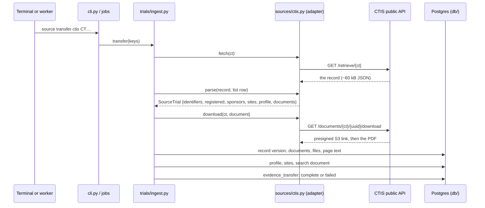
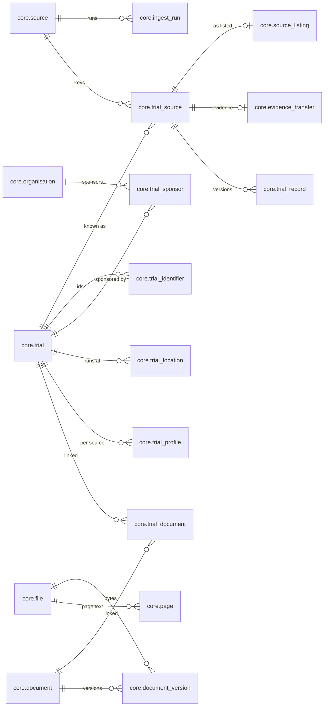

# Sources and gold datasets

Trials and documents come from **sources** through adapters into one **central model** (schema `core`), whatever
the source ([ADR-003](adr/ADR-003-sources-and-gold-datasets.md),
[ADR-005](adr/ADR-005-data-sources-in-stages.md)). Hand-checked answers to compare our checks with are **gold
datasets**: versioned files in `data/gold/`, never in the database.

## Sources

A source (`core.source`) is a registry such as CTIS, a publication index, or manual entry. A registered source
names the adapter that reads it (`src/trialwatch/sources/registry.py`) and holds one current config, checked by
the adapter: what its list holds and which evidence a transfer brings. It can be switched off. Every stored record
carries (source, the source's own key), unique, so fetching it again adds a version instead of a duplicate.

An adapter only reads its source and never writes to the database: its list page by page, and per trial `fetch`
(the record as the source gives it), `parse` (the record read into a `SourceTrial`: identifiers, the registered
information checks ask about, sponsors, sites, the profile for patient search, and the documents it lists) and
`download` (a document's file). Saving is the same for every source (`src/trialwatch/trials/ingest.py`), so adding a
registry such as ClinicalTrials.gov means writing one adapter. `parse` also reads stored records, so readings are
rebuilt without fetching anything.

Trials come in in two stages:

1. **Sync the list** (`source sync CODE`, or Sync list on the source's page): read every trial the source lists,
   as its config filters them, and match each to a trial here by its key and identifiers (or create it), with what
   the list says in `core.source_listing`. Nothing but the list is fetched. CTIS answers at most 10,000 rows per
   query, so a longer list is read in EU CT number order from both ends: ascending, then descending until it
   reaches the trials the ascending pass read. A trial seen twice in one pass is skipped (the list shifted while it
   was read). A trial is marked no longer listed (kept) only when two complete syncs in a row missed it. A sync
   also marks the trials the list calls recruiting.
2. **Transfer evidence** (`source transfer CODE`, Transfer on a source's or trial's page;
   `src/trialwatch/trials/ingest.py`): a trial's full record, the documents of the kinds the source's config
   names and their page text, its profile and its sites. For CTIS, `evidence.document_kinds` is by default the
   summary of results and the clinical study report; lay summaries only if the config asks (they are often one per
   language, and no check reads them). A document the source no longer lists is unlinked from the trial (kept).
   `core.evidence_transfer` records the transfer as `complete` (everything came in and was read) or `failed`
   (with what), and the document kinds it brought. While a trial is being transferred its row says failed, so an
   interrupted transfer never looks complete. Trials are chosen by key, or all `pending` (listed, never
   transferred), `failed`, `stale`, `recruiting` or `listed` ones.

Both stages are **ingest runs** (`core.ingest_run`, kind `list` or `transfer`) that log the config they used, their
counts and errors; their audit entries carry the note "ingest run N". One process at a time syncs or transfers
from a source (an advisory lock).

### Evidence state

`core.evidence_status` says, per trial and source: not transferred, failed, stale (complete, but the source changed
the trial since) or complete. The source's list gives the day of a trial's last change, not the time, so a trial
counts as stale when that day is the transfer's day or later: a trial changed on the day of its transfer stays
stale until a transfer on a later day. Every transfer also downloads each listed document again and compares its
bytes, so a file replaced without a new version number is caught too.

A check reads a trial only when every source that holds it is complete and current, and its transfer brought
every document kind the check reads that the source can give (`not_ready` in `trials/readiness.py`). A trial entered
by hand is complete once its uploaded documents are read.

### One transfer, step by step



`CtisClient` waits at least 1 s between requests and tries 5 times, backing off on 429 and 5xx; an empty `{}`
answer means the trial doesn't exist (`TrialNotFound`).

### Trials, identity and documents

- **Trial identifiers** (eu-ct, eudract, nct, isrctn, who-utn, or trialwatch for trials added by hand) are
  normalised and unique in `core.trial_identifier`, so each points to one trial; incoming records are matched by
  all their identifiers. A value not valid for its scheme (e.g. an NCT number given as "N/A") is skipped. From
  CTIS: the EU CT number, the EudraCT number, and the NCT, WHO UTN and ISRCTN numbers.
- **Identity.** A source's key always belongs to one trial (`core.trial_source`), and a new key never joins a trial
  that already has another key at the same source: an extension that names its parent's NCT number becomes its
  own trial, plus a **possible duplicate** for a person to decide (merged or distinct; never automatic). One
  process at a time decides identities (an advisory lock).
- **Trial record.** What one source says about a trial (`core.trial_record`): the payload as received plus
  `registered`, the adapter's normalised reading (titles, status, dates, endpoints). A new row only when the
  content differs.
- **Sponsors.** Organisations are stored once (`core.organisation`), found by an identifier a source gives (CTIS:
  EMA's organisation id, `ema-org`, ORG-…), else by the same name. `core.trial_sponsor` links a trial to one
  primary sponsor and any co-sponsors; a sponsor the source stops listing is kept as removed, and one a person
  removed stays removed.
- **Locations.** Where a trial runs (`core.trial_location`): a site (its organisation, city, postcode) in a
  country, or a country with no site listed, with the trial's status there. People at a site are never stored.
  `source locations ctis` reads them again from stored records.
- **Files, documents, versions** (three layers): `core.file` holds the bytes once by sha256 (with a text
  fingerprint to spot the same text in other bytes); `core.document` is the document as its source identifies it;
  `core.document_version` says which file it had from when, keeping replaced ones (CTIS serves only the current
  version, so every version we download is kept). `core.trial_document` links documents to trials with basis and
  confidence. Each file's page text is extracted once with pypdf (`core.page`, `trials/pages.py`); only PDFs are
  read. Each file is read in a child process of its own: pypdf needs about ten times a file's size while it reads
  (a 38 MB, 3,000-page CTIS study report: 420 MB), and the child gives that memory back when it ends. A child that
  runs out of memory or takes over 20 minutes fails only its file, like a broken PDF. A CTIS document over 300 MB
  is not downloaded (failed as too large), and a file already stored is not sent to the database again. pypdf's
  budget for parsing one page's content stream is raised from 2 to 10 million: pages of dense tables in CTIS
  study reports went over the default and failed their whole file.
- **Manual source.** Trials and documents a person enters (`sources/manual.py`): the "Add a trial" form and
  "Upload a document" on a trial page. Identifiers are matched first, so a known trial is never added twice; a
  trial without a registry identifier gets its own TW-number. PDF files only.
- **Audit log.** `core.audit_log`: every insert, update and delete on the central tables, with actor, time and the
  row before and after, written by Postgres triggers in the same transaction; never updated, deleted or
  truncated. An **actor** (`core.actor`) is a person or a process; actor 1 is `trialwatch` itself. Writes without
  an actor are refused.

### Commands

```bash
uv run trialwatch source list
```

```bash
uv run trialwatch source sync ctis
```

```bash
uv run trialwatch source transfer ctis --which pending --limit 20
```

`source transfer ctis 2025-522750-39-00 …` takes EU CT numbers instead. `source config ctis --config <file>` replaces a source's config (CTIS:
`listing.criteria` are the fields of its search, e.g. `{"status": [8], "hasStudyResults": true}`;
`evidence.document_kinds` the kinds to transfer), `--disable` switches a source off, `source register` adds a
source read by another adapter, and `source locations ctis` reads again where each stored trial runs without
fetching anything.

| Where | What |
|---|---|
| `sources/registry.py` | registered sources, the adapter interface, `SourceTrial` |
| `sources/ctis.py`, `ctis_client.py` | the CTIS adapter (reads only) and its HTTP client |
| `sources/manual.py` | trials and documents added by hand |
| `sources/snapshot.py` | the frozen snapshot for gold evaluations, for any adapter |
| `trials/ingest.py` | sync, transfer, saving what an adapter read |
| `trials/readiness.py` | `not_ready`: may a check read it? |
| `trials/pages.py` | page text |
| `trials/routes.py`, `sources/routes.py` | the trials' pages (one trial gathers its judgements, search view and gold items), adding trials by hand, the stored files; the sources' pages |
| `db/core.py` | the central model's SQL |

## Central model tables



| Table | What it holds |
|---|---|
| `core.actor` | a person or a process that changes data (1: `trialwatch` itself) |
| `core.audit_log` | every change to an audited table, written by triggers; never updated, deleted or truncated |
| `core.source` | where data comes from: code, kind (registry, publications, manual), adapter, enabled, config |
| `core.ingest_run` | one run of a source adapter (list or transfer): what it was asked, status, counts, errors |
| `core.identifier_scheme` | identifier kinds and the pattern a value must match (eu-ct, eudract, nct, isrctn, who-utn, trialwatch, ema-org) |
| `core.trial` | a trial, whatever the source: our own id; `merged_into` when a person confirms a duplicate |
| `core.trial_identifier` | every known id, normalised, pointing to one trial |
| `core.trial_source` | a source's own key → one trial |
| `core.trial_record` | what a source says, one row per version: payload as received, `registered` normalised |
| `core.trial_record_current` (view) | the latest record per source and trial |
| `core.possible_duplicate` | two trials that may be one: open, merged or distinct, decided by a person |
| `core.organisation`, `core.organisation_identifier` | an organisation (a sponsor), stored once, and its ids |
| `core.trial_sponsor` | a trial's sponsors: one primary, any co-sponsors; removed ones kept, with who removed them |
| `core.source_listing` | what a source's list says about each trial: title, last change, the listed row, first and last listed, delisted, recruiting |
| `core.evidence_transfer` | did a trial's evidence come in completely: complete or failed, when, by which run, the kinds it brought |
| `core.evidence_status` (view) | each trial's state at each source: not transferred, failed, stale, complete |
| `core.trial_location` | where a trial runs: country, city, postcode, site, status there; no people |
| `core.file` | the bytes, once per sha256 (never changed), with a text fingerprint |
| `core.page` | text of each page of a file (never changed), with a full-text index |
| `core.document_kind` | our document kinds: results-summary, lay-summary, study-report, publication, protocol, other (`has_results`) |
| `core.document` | a document as its source identifies it (CTIS uuid, DOI, upload id), with its kind |
| `core.document_version` | which file a document had from when; `replaced_at` NULL = current |
| `core.document_current` (view) | each document's current version |
| `core.trial_document` | which documents belong to which trial: basis (listed-by-source, identifier-in-text, manual), confidence, removal |

CTIS document types map to our kinds: 103 results-summary, 46 lay-summary, 45 study-report, 104 and 7 protocol,
any other "other". CTIS's other codes stay in the record as received.

## CTIS public API

`euclinicaltrials.eu/ctis-public-api`: unofficial, undocumented, no auth. Fields as seen in real responses on
2026-10-31. `*` = a field TrialWatch relies on. Types: str, int, bool, list, obj; date = `YYYY-MM-DD`, ts = ISO
timestamp; `->` = where it goes. CTIS timestamps carry no time zone (e.g. `2026-08-14T03:37:46.157584519`) and the
API does not say which one; TrialWatch reads a results submission date as UTC, still to be confirmed.

```text
POST /search — request body. List trials page by page (source sync, CtisClient.search)
  pagination.page               int   page number, starts at 1
  pagination.size               int   rows per page (500 at most)
* sort.property                 str   we send ctNumber: stable paging
* sort.direction                str   ASC, then DESC
* searchCriteria                obj   the config's listing.criteria,
                                      + containAll/Any/Not, empty
At most 10,000 rows per query (seen 2026-11-21): a longer list is read
ascending, then descending down to the trials the ascending pass read.
A trial seen twice in one pass is skipped.

POST /search — response. One short summary per trial; dates are dd/mm/yyyy text
* pagination.totalRecords       int   trials matching (12,905 on 2026-11-21)
  pagination.totalPages         int   pages at this page size
* pagination.nextPage           bool  false on the last page
  showWarning                   bool  portal hint, ignore
  data[]                        list  one summary per trial, kept
                                      as core.source_listing.summary:
*   ctNumber                    str   EU CT number: the source key
    ctStatus                    int   status code
*   ctTitle, shortTitle         str   ctTitle -> core.source_listing
    sponsor, sponsorType        str   sponsor name and type, as text
    trialPhase                  str   phase as text, not a code
    trialRegion                 int   region code
    trialCountries              list  "Italy:2" = country:sites
    ageGroup, gender            str   comma-separated text
    totalNumberEnrolled         str   planned participants
    resultsFirstReceived        str   "Yes" | "No": results posted?
    decisionDateOverall         str   authorised on, dd/mm/yyyy
*   lastUpdated                 str   last change: evidence goes stale
    lastPublicationUpdate       str   last republish, dd/mm/yyyy

GET /retrieve/{ctNumber} — response. Full record (~60 kB), stored untouched in
core.trial_record.payload. Unknown number: 200 with {}
* ctNumber                      str   EU CT number
* ctStatus                      str   status as text -> registered
  ctPublicStatusCode            int   the same status as a code
  trialRegionCode               int   region code
  decisionDate                  ts    first authorisation decision
* startDateEU, endDateEU        date  started, ended in the EU/EEA
  publishDate                   ts    republished on (not hashed)
  events                        obj
    trialGlobalEndDate          date  ended everywhere
    trialEvents[]               list  per country: early end, halts
      .earlyTerminationReason   obj   reason code
  results                       obj
*   summaryResults[]            list  technical results summary posted
*   laypersonResults[]          list  plain-language summary posted
*     .id                       int   named by a document's associatedEntityId
*     .submissionDate           ts    when it was submitted ->
                                      that document's published_at
  documents[]                   list  every published file:
*   uuid                        str   id for /documents download
*   documentType                str   -> our kind: 103 results-summary,
                                      46 lay-summary, 45 study-report,
                                      104 / 7 protocol, others other
*   systemVersion               str   goes up when the file is replaced
*   associatedEntityId          int   the results submission it is in
    title, fileType             str   file name; usually PDF
  authorizedApplication         obj   the authorised trial itself:
*   eudraCt.eudraCtCode         str   EudraCT number (moved-over trials)
    memberStatesConcerned[]     list  countries: mscName, status
    authorizedPartI             obj   the part shared by all countries:
*     .clinicalTrialIdentifiers obj   titles: full, public, short;
                                      .secondaryIdentifyingNumbers:
                                      NCT, WHO UTN, ISRCTN, and other
                                      registries (EudraCT among them)
      .trialCategory.trialPhase str   phase code
*     .trialDuration            obj   estimated global end date
*     .endPoint                 obj   primaryEndPoints[]: what the
                                      evidence check asks about
      .ageRanges[]              list  age range codes
*     .sponsors[]               list  organisation (name, businessKey
                                      ORG-…, type), primary,
                                      isCommercial -> core.organisation
      .products[]               list  medicines and their role
    authorizedPartsII[]         list  per country: sites, status history

Long paths are shortened: .trialCategory, .trialDuration and .endPoint sit under
authorizedPartI.trialDetails.trialInformation, and .clinicalTrialIdentifiers
under authorizedPartI.trialDetails. Full paths: src/trialwatch/sources/ctis.py.

GET /documents/{ctNumber}/{uuid}/download. Two steps (source transfer,
CtisClient.download_document)
Step 1: CTIS answers with JSON
* url                           str   presigned S3 link, valid ~5 min
Step 2: GET that url
  (body)                        PDF   the file itself, e.g. type 103
Fetch step 2 right away: the link expires.
```

The fields patient search reads are on the [search page](search.md#external-data).

### Europe PMC (planned)

Not built yet. From public docs, not yet checked against live data:

```text
GET /rest/search   base: ebi.ac.uk/europepmc/webservices/rest
Request (query string)
  query                         str   e.g. the CT or EudraCT number
  format                        str   json
  resultType                    str   lite | core (core adds abstract)
  pageSize                      int   results per page, up to 1000
  cursorMark                    str   * for page 1, then nextCursorMark
Response
  hitCount                      int   total matches
  nextCursorMark                str   token for the next page
  resultList.result[]           list  one per publication:
*   pmid, pmcid, doi            str   publication identifiers
*   title, journalTitle         str   what and where
*   firstPublicationDate        date  when it appeared
    isOpenAccess                str   Y | N
```

## Gold datasets

A gold dataset is a named, versioned set of hand-checked answers per trial, kept as files in
`data/gold/<name>/<version>/` (ADR-003), never in the database: `dataset.json` says what it is, which requirement
set its labels answer and which documents its reviewers read (the evidence scope, with the day they read them);
`items.jsonl` holds one **gold item** per line: its identifiers (any scheme), the expected parts and label, each
reviewer's answers and comments, and the source's own details. An item without a label (e.g. no document to read)
stays searchable but is not compared. Bruckner et al. is the first ([their data](../data/bruckner/README.md)):
their final verdicts and each reviewer's answers per part, in `bruckner/2026-03-16`.

- **Build** with a converter per source: `uv run trialwatch gold build bruckner` (`gold/converters/bruckner.py`; each converter is registered in `gold/converters/__init__.py`). Run it on
  this machine, not in the container: the app container sees `data/` read-only and reads the datasets from
  `TRIALWATCH_GOLD_DIR`.
- **Versions are locked.** `data/gold/versions.lock` holds the sha256 of both files of every released version. A
  released version never changes (`gold build` refuses, `gold datasets` and a test report any drift); a corrected
  or larger dataset is a new version. The one exception to "no versioning before production".
- **List** with `uv run trialwatch gold datasets`; the web interface's Gold page searches them (identifiers,
  titles, reviewers' comments; filters by gold label, reviewer disagreement and our result) and puts our newest
  judgement next to each item's expected answers, with false accusations flagged. A gold item whose evidence is
  not here yet can be transferred from its page, and a trial page shows the gold items that name it.
- **Score a run** with `uv run trialwatch gold compare --run N` (`--dataset bruckner/2026-03-16` picks which;
  `gold/compare.py`). A **false accusation** (ours not full, theirs full) is the costliest error and counted
  separately. An item is **set aside** when our check read a document version posted on or after the day the
  reviewers read theirs: ours and theirs may be different documents.

### Gold evaluations (CI)

Two GitHub Actions pipelines run our whole workflow on the Bruckner gold dataset and compare the results with the
reviewers' labels (ADR-001): they transfer each trial's evidence, run the evidence check with the real model,
score the run, and fail when a gate in their gates file (`evals/gates/`) is missed. Both are started by hand
from the Actions tab and cost API money; they need the `ANTHROPIC_API_KEY` repository secret.

- **Gold evaluation · full** (`.github/workflows/eval-full.yml`, `evals/gates/full.json`): every labelled item
  (206), up to six hours. Fixed gates: label agreement at least 90% where we decided, no false accusations, at most
  20% left undecided, at most 10% not compared.
- **Gold evaluation · short** (`.github/workflows/eval-short.yml`, `evals/gates/short.json`): the 50 hardest
  labelled items, listed in `evals/hard-50.txt` (reviewers disagreed, the team discussed it, the trial was
  terminated, … ; at least 15 of each label), checked **three times** on the same evidence. Most of these are
  items Bruckner's own reviewers disagreed on, so fixed shares say little about them; the short evaluation is a
  regression check instead: no **clear** false accusation, at most 2 items worse than its accepted baseline
  (`evals/baselines/gold-short.json`) in items disagreeing with the gold label and in items decided, no item
  "not full" in one of the three runs and "full" in another (items moving between a label and "undecided" are
  listed, not gated), at most 10% not compared.

**Measures.** A false accusation (ours not full, theirs full) is **clear** when no reviewer's own reading of the
item (their parts, under the requirement set's label rules) was an accusation, and **contested** when at least
one reviewer read it as we did; both are counted, the gates name which they limit. The report also counts the
decided items that agree with the final label or with at least one reviewer. With repeated runs (`--repeat N`),
shares are the runs' median, accusations the worst run's, and the items whose label changed between runs are
listed. It also measures retrieval (no gate): how many trials were searched rather than sent whole, and of the
questions asked again with every page, how many were then answered with a verified quote on a page the search
had not shown (a search miss), as a search hit rate.

**The report** is on the run's summary page and kept as an artifact (30 days) with every answer and judgement
as CSV (`ops/eval/export.sql`) and the runs' measures as `gold-eval-baseline.json`. For each item ours disagrees
on or leaves undecided, it shows every question: its value, the rule that set it, and the model's answer (found,
kind, page, the quote and the model's note), so a failure can be read without the run's database.
**Accepting a baseline:** when a short run's result is accepted, commit its `gold-eval-baseline.json` as
`evals/baselines/gold-short.json` (or run `gold eval … --repeat 3 --write-baseline evals/baselines/gold-short.json`
locally).

Both call `.github/workflows/eval-shared.yml`, which runs the same command you can run locally (it calls the
model):

```bash
uv run trialwatch gold eval --dataset bruckner/2026-03-16 --sample evals/hard-50.txt --snapshot snapshot.tar.gz --gates evals/gates/short.json --repeat 3
```

Without `--snapshot` it reads live CTIS. The sample is made by
`trialwatch gold sample --dataset bruckner/2026-03-16 > evals/hard-50.txt`; a test fails if the file no longer
matches.

**The frozen snapshot.** The evidence comes from a frozen snapshot, not live CTIS, so every run reads the same
records and documents and a score changes only when our code, prompt or model does. The snapshot is CTIS's raw
answers (each trial's record and document files), recorded once while transferring the gold trials and replayed
to the same CTIS adapter: the transfer, page text extraction, retrieval and check run exactly as for a live
trial, with only the network left out (`src/trialwatch/sources/snapshot.py`). It is made by the **Gold snapshot**
workflow (`.github/workflows/gold-snapshot.yml`, by hand; it calls CTIS, not the model), which uploads the
`.tar.gz` to a new GitHub release and prints the lock to commit as `evals/snapshot.lock.json`. The pipelines
download the release file the lock names and refuse it if its sha256 differs. Until a snapshot is committed, they
stop with that message. The snapshot is today's CTIS, not the reviewers' 2025-11-10 view: trials whose documents
were posted after that day are still set aside.

`trialwatch gold snapshot --dataset bruckner/2026-03-16 --out FILE --release TAG` makes a snapshot locally (it
writes the lock too). Recording and replaying wrap the source's adapter at `fetch` and `download`, so they work
for any source.

| Where | What |
|---|---|
| `gold/datasets.py` | reading and searching gold datasets, the version lock |
| `gold/converters/` | the converters, one per benchmark (`bruckner.py`: their CSVs → `data/gold/`) |
| `gold/compare.py` | scoring a run against a dataset |
| `gold/evaluate.py` | `gold eval`: the whole workflow on a gold dataset |
| `gold/routes.py`, `gold/views.py` | the gold pages; a dataset's items next to our judgements (also on a trial's page) |
| `sources/snapshot.py` | recording and replaying the frozen snapshot |
